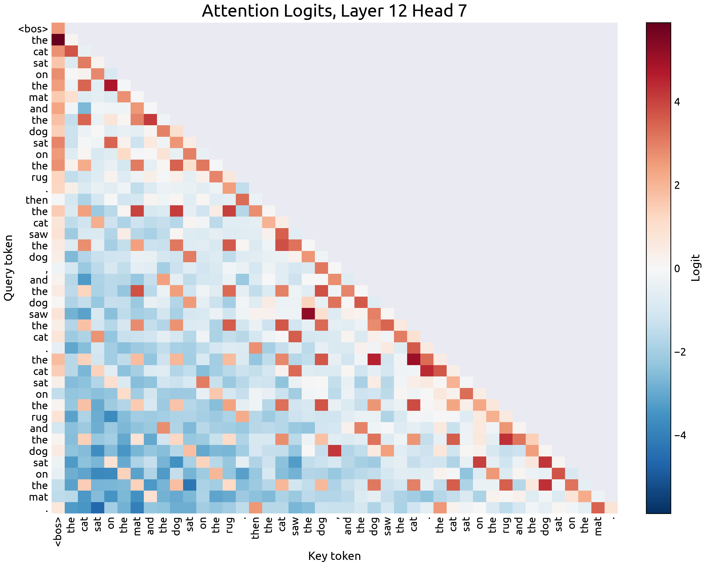
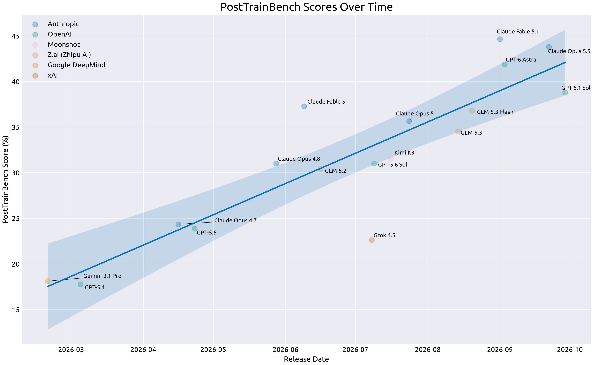
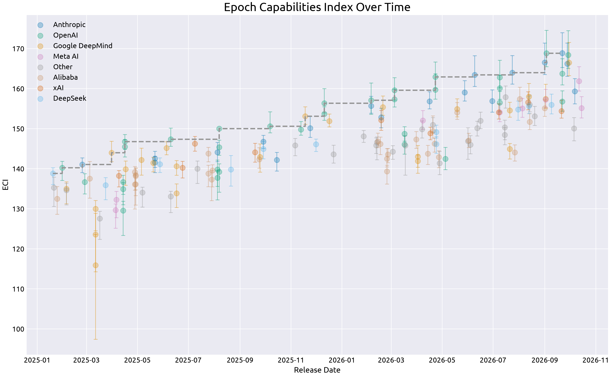

# Snow

Snow is an opinionated, functional data visualization library for machine learning experiments and evaluation. Snow does not provide first-class options to alter themes, layouts, fonts, or rendering. Snow is built on top of matplotlib.

## Examples

A heatmap, from [`examples/heatmap_plot.py`](examples/heatmap_plot.py):

```python
cells = snow.heatmap(logits, row_tick_labels=tokens, column_tick_labels=tokens, midpoint=0, hidden_cells=causal_mask, colorbar_label="Logit")

panel = snow.Panel(layers=(cells,), y_axis=snow.Axis(label="Query token"))
chart = snow.Chart(panels=(panel,), layout=snow.Layout.HEATMAP, title="Attention Logits, Layer 12 Head 7", x_axis=snow.Axis(label="Key token"))

snow.save(chart, "heatmap_plot.png")
```



A scatter plot with a trendline, from [`examples/line_scatter_plot.py`](examples/line_scatter_plot.py):

```python
points = snow.scatter(scores, x="release_date", y="score", point_labels="model_name", color=snow.ColorBy("lab"))
fit = snow.trendline(scores, x="release_date", y="score")

panel = snow.Panel(layers=(points, fit), y_axis=snow.Axis(label="PostTrainBench Score (%)"))
chart = snow.Chart(panels=(panel,), title="PostTrainBench Scores Over Time", x_axis=snow.Axis(label="Release Date"))

snow.save(chart, "line_scatter_plot.png")
```



A scatter plot with a frontier, from [`examples/frontier_scatter_plot.py`](examples/frontier_scatter_plot.py):

```python
points = snow.scatter(scores, x="release_date", y="eci", y_low="eci_low", y_high="eci_high", color=snow.ColorBy("lab", colors=lab_colors))
frontier = snow.frontier(scores, x="release_date", y="eci")

panel = snow.Panel(layers=(points, frontier), y_axis=snow.Axis(label="ECI"))
chart = snow.Chart(panels=(panel,), title="Epoch Capabilities Index Over Time", x_axis=snow.Axis(label="Release Date"))

snow.save(chart, "frontier_scatter_plot.png")
```


